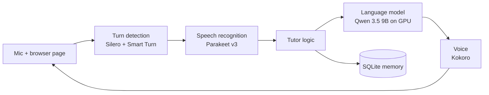

# Spanish Companion

**A Spanish tutor you can call like a friend: live voice conversation, interruptions
included, running 100% on your own PC.**

No cloud APIs and no subscriptions, and your voice never leaves the machine. The
companion chats in English, slowly brings Spanish in at your level, corrects you kindly
(one thing at a time), remembers your mistakes and words between calls, and brings them
back with spaced repetition.

> Status: **Phase 0**, measuring each part on the target hardware. See the [roadmap](#roadmap).

## What it will do

- **Live calls.** Speak naturally. It answers in about a second, and you can interrupt it.
- **A friend, not a strict teacher.** Mostly English at first, with Spanish words, short
  phrases and small challenges ("How would you say that in Spanish?").
- **Gentle corrections.** One correction per turn, explained in a few words, then try again.
  Each correction is double-checked so it doesn't teach you wrong Spanish.
- **Memory and spaced review.** Recurring mistakes and new words are stored locally and
  scheduled with [FSRS](https://github.com/open-spaced-repetition/py-fsrs).
- **Voice tasks.** "Write down my mistakes", "List today's new words", "Make me an
  exercise", "What did I struggle with this week?" Each is saved as a Markdown note.
- **Rehearsal mode.** Practise a short presentation line by line.

## How it works



Everything is designed around one constraint: **an 8 GB GPU**. The language model gets
the GPU; speech recognition, the voice and turn detection run on the CPU. Details, memory
budget and latency targets: [docs/architecture.md](docs/architecture.md).

| Job | Tool | Why |
| --- | --- | --- |
| Pipeline, turn-taking, barge-in | [Pipecat](https://github.com/pipecat-ai/pipecat) | Open-source real-time voice framework |
| Language model | Qwen 3.5 9B (Q4_K_M) on [llama.cpp](https://github.com/ggml-org/llama.cpp) | Best 8 GB model for multilingual chat and tool use |
| Speech recognition | [Parakeet TDT 0.6B v3](https://huggingface.co/nvidia/parakeet-tdt-0.6b-v3) via [onnx-asr](https://github.com/istupakov/onnx-asr) | English, Spanish and French; fast on CPU |
| Voice | [Kokoro 82M](https://huggingface.co/hexgrad/Kokoro-82M) | Fast, natural, Apache 2.0, English and Spanish voices |
| Turn detection | Silero VAD + [Smart Turn v3](https://github.com/pipecat-ai/smart-turn) | Knows a pause for thought from the end of a sentence |
| Grammar second opinion | [LanguageTool](https://languagetool.org/) (local server) | Rule-based check on the model's corrections |
| Memory | SQLite + FSRS | One local file, standard spaced repetition |

## Roadmap

- [ ] **Phase 0: measure the parts.** Benchmark the model, recognizers and voice on an RTX 4060 ([guide](docs/phase0.md))
- [ ] **Phase 1: first call.** Live voice loop in the browser with interruption and subtitles
- [ ] **Phase 2: tutor brain.** Checked corrections, two-language voice, beginner-friendly patience
- [ ] **Phase 3: memory.** Session log, summaries, FSRS review, level adaptation
- [ ] **Phase 4: voice tasks.** Notes, word lists, exercises, weekly report, Anki export
- [ ] **Phase 5: rehearsal mode.** Practise a presentation line by line
- [ ] **Later:** echo cancellation for speakers, pronunciation feedback, streaming recognition

## Getting started

Phase 0 is runnable today: see [docs/phase0.md](docs/phase0.md) for setup on Windows 11
with an NVIDIA GPU.

```bash
uv venv --python 3.12 && uv pip install -e ".[phase0,dev]"
pytest
```

## Project layout

```
src/companion/      core package (language tagging, metrics, prompts)
scripts/phase0/     hardware checks and benchmarks
docs/               architecture and setup guides
tests/              unit tests (run in CI)
```

## Privacy

All audio is processed locally and is not saved unless you record test samples yourself.
Models, recordings and learning data are git-ignored.

## License

[MIT](LICENSE). Model weights keep their own licences (Qwen: Apache 2.0, Parakeet: CC BY 4.0,
Kokoro: Apache 2.0).
